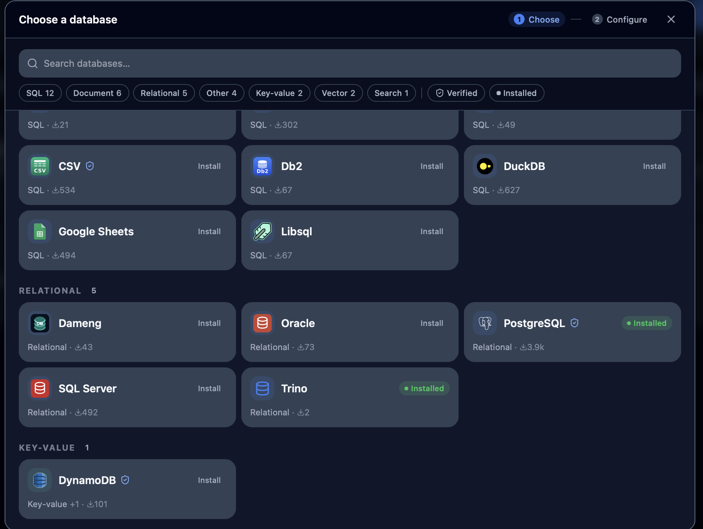
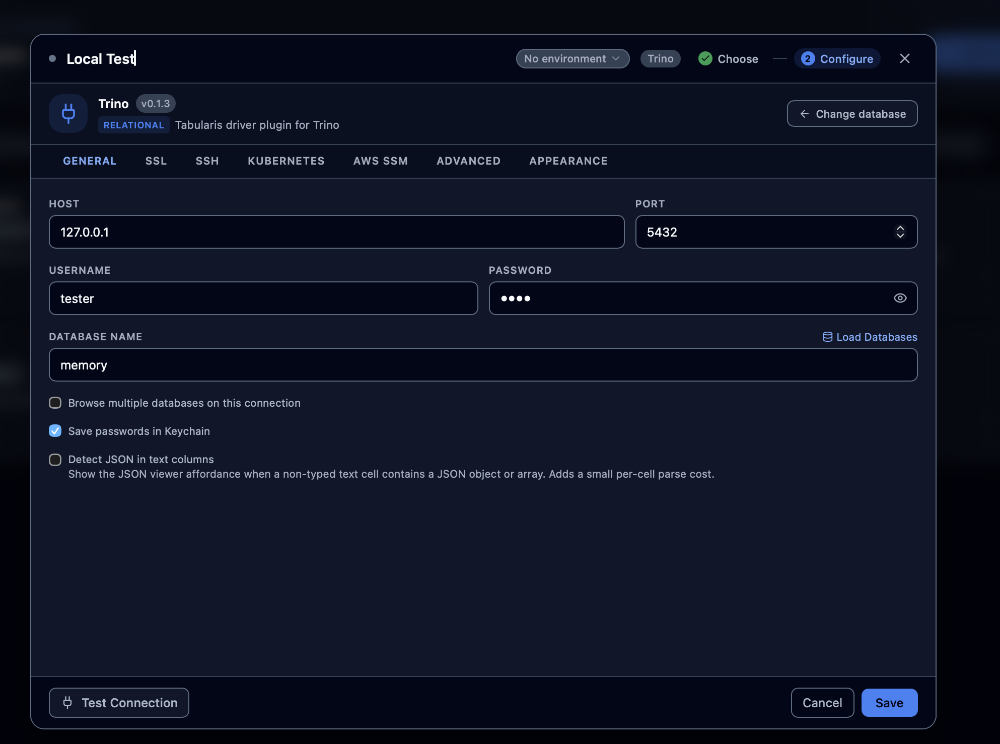
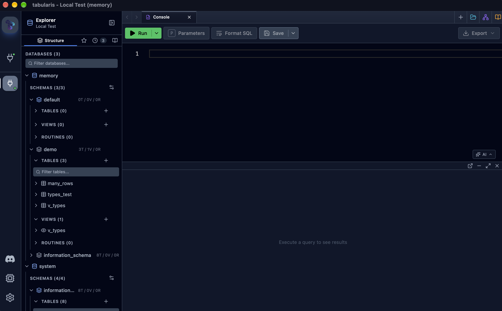
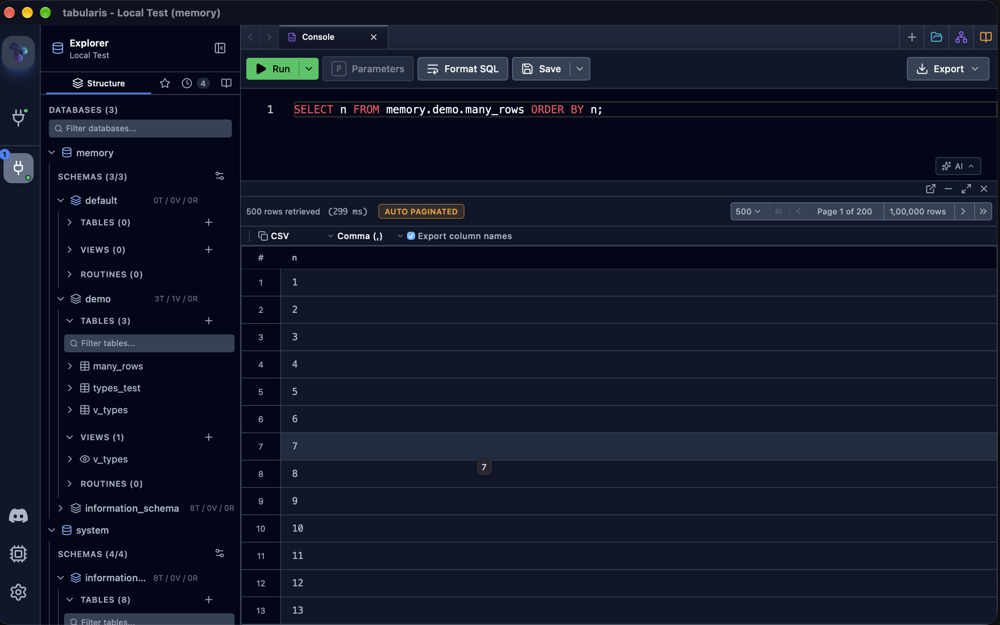

<div align="center">
  <picture>
    <source media="(prefers-color-scheme: dark)" srcset="https://raw.githubusercontent.com/TabularisDB/tabularis/main/.github/assets/banner-dark.png" />
    
  </picture>

  <br/>

  <picture>
    <source media="(prefers-color-scheme: dark)" srcset="https://raw.githubusercontent.com/TabularisDB/tabularis-trino-plugin/main/assets/trino-banner-dark.png" />
    
  </picture>
</div>

# tabularis-trino-plugin

<p align="center">

[](https://github.com/TabularisDB/tabularis-trino-plugin/releases)

[](https://github.com/TabularisDB/tabularis-trino-plugin/actions/workflows/release.yml)

</p>

A [Trino](https://trino.io/) driver plugin for [Tabularis](https://github.com/TabularisDB/tabularis),
the open-source database client.

This plugin connects Tabularis to Trino through a standalone Rust executable
that implements JSON-RPC 2.0 over stdio. Browse catalogs, schemas, tables, and
views, then run SQL in the editor or SQL notebooks—including federated queries
across catalogs.

> **Requires Tabularis v0.26.0 or later** for query cancellation support.

## Table of Contents

- [Features](#features)
- [Screenshots](#screenshots)
- [Connection Configuration](#connection-configuration)
- [Installation](#installation)
  - [From the Tabularium registry](#from-the-tabularium-registry)
  - [Manual Installation](#manual-installation)
- [How It Works](#how-it-works)
- [Supported Operations](#supported-operations)
- [Building from Source](#building-from-source)
- [Development and Testing](#development-and-testing)
- [License](#license)

## Features

- **Catalog and schema browsing** — Discover catalogs, schemas, tables,
  columns, views, view definitions, and view columns visible to the Trino user.
- **Query execution** — Run SQL in the Tabularis editor and notebooks, including
  federated queries across configured catalogs.
- **Complete results** — Follow Trino's result-page links and preserve row
  order, including when a response page contains no rows. Support requested
  result limits and offsets.
- **Cancellation** — Send cancellation to Trino through its client protocol
  when Tabularis cancels a running query.
- **Query diagnostics** — Return Trino's query ID, final state, states observed
  while collecting pages, client elapsed time, and selected Trino timing/split
  statistics. Trino errors include the query ID, error code/type, and SQL
  location when the coordinator provides them.
- **Exact values** — Preserve NULL, DECIMAL, large integers, ARRAY, MAP, and ROW
  values without silent precision loss.
- **Secure authentication** — Support unauthenticated local development,
  HTTP Basic authentication, JWT/OAuth2 access tokens, and OAuth2 external
  (browser) authentication, for example with Keycloak. Credentials are only
  sent over HTTPS.
- **TLS configuration** — Support SSL modes, a custom CA certificate, an
  optional client certificate/private key pair, and relaxed certificate
  verification (`SSLVerification=CA` or `NONE`) for self-signed deployments.
- **Cross-platform releases** — The release workflow builds for Linux x64/arm64,
  macOS x64/arm64, and Windows x64.

This plugin is read-only. Grid editing, CRUD, DDL actions, and Visual
EXPLAIN are not supported. Presto compatibility has not been evaluated.

## Screenshots









The connection screenshot uses a local test account; the password is masked.

## Connection Configuration

| Tabularis field | Description |
| --- | --- |
| Host | Trino coordinator hostname or URL. Use an `https://` URL for HTTPS. Append [connection options](#connection-options) as a query string. |
| Port | Coordinator port. Defaults to `8080`, the usual Trino HTTP port (HTTPS deployments often use `443` or `8443`). The local fixture maps host port `5432` to container port `8080`, so set `5432` when using it. |
| Database name | Default Trino catalog. Enable multiple database browsing to browse additional catalogs. |
| Schema | Optional default schema for browsing and query context. |
| Username | Trino user; defaults to `tabularis` when blank. With token or external authentication, leave it blank to use the user from the token. |
| Password | Optional; password authentication requires HTTPS. With `authentication=token`, holds the access token. |
| SSL mode | Disabled, Preferred, Required, Verify CA, or Verify Identity. |
| CA certificate | Optional PEM content or a path to a PEM file. |
| Client certificate/key | Optional PEM content or file paths. Provide both when mutual TLS is required. |

The connection-string field is not used. Configure the coordinator and catalog
through the standard connection fields.

### Connection options

Trino-specific options are appended to the Host field as a query string, using
the Trino JDBC driver's property names:

```text
https://trino.example.com?externalAuthentication=true&SSLVerification=NONE
```

| Option | Description |
| --- | --- |
| `SSL` | `true` connects over HTTPS when the host has no `https://` scheme. |
| `SSLVerification` | `FULL` (default) checks the certificate chain and hostname; `CA` skips the hostname check; `NONE` accepts any certificate. Implies `SSL=true`. Prefer providing a CA certificate over `NONE`. |
| `externalAuthentication` | `true` enables OAuth2 browser login (Trino `http-server.authentication.type=oauth2`, e.g. Keycloak). On the first request the plugin opens the login page in your default browser and waits for the token. The token is reused for the plugin process lifetime and refreshed when Trino rejects it. Leave the password blank. |
| `externalAuthenticationTimeout` | Seconds to wait for the browser login. Defaults to `110`, below Tabularis' default 120 second plugin call timeout. |
| `accessToken` | A JWT/OAuth2 access token sent as `Authorization: Bearer`. The Host field is stored in plain text, so prefer `authentication=token`. |
| `authentication` | `token` sends the Password field as a bearer access token (stored like a password). `password` and `external` are also accepted. |

Token and external authentication require HTTPS, except for `localhost`
coordinators. If the browser cannot be opened, the login URL is written to the
plugin log and included in the timeout error.

## Installation

### From the Tabularium registry

In Tabularis, open **Settings → Plugins**, search for **Trino**, and install it.
The plugin is also listed on the
[Tabularium registry](https://registry.tabularis.dev/plugins/trino).

### Manual Installation

1. Download the archive for your operating system and architecture from the
   [GitHub Releases page](https://github.com/TabularisDB/tabularis-trino-plugin/releases).
2. Extract the archive. It contains the plugin executable and `.tabularium`
   manifest.
3. Copy both files into the Trino plugin directory:

   | OS | Plugin directory |
   | --- | --- |
   | **Linux** | `~/.local/share/tabularis/plugins/drivers/trino/` |
   | **macOS** | `~/Library/Application Support/tabularis/plugins/drivers/trino/` |
   | **Windows** | `%APPDATA%\tabularis\plugins\drivers\trino\` |

4. Restart Tabularis or toggle the Trino plugin off and on in Settings.

For a local development build, use `just dev-install` from this repository.

## How It Works

The plugin is a standalone Rust executable that communicates with Tabularis
using **JSON-RPC 2.0 over stdio**:

1. Tabularis starts the plugin as a child process.
2. Tabularis sends newline-delimited JSON-RPC requests through the plugin's
   standard input; the plugin writes responses to standard output.
3. The plugin submits SQL to Trino's `/v1/statement` endpoint, follows each
   `nextUri` until the statement finishes, and sends an HTTP `DELETE` to cancel
   a running statement when requested.

Catalog and schema context comes from each connection/request. Catalogs map to
Tabularis databases, and Trino metadata visibility follows the connected
Trino user's permissions.

## Supported Operations

| Operation | Support |
| --- | --- |
| Connection test | Supported (`SELECT 1`) |
| Catalog discovery | Supported (`get_databases`) |
| Schema discovery | Supported (`get_schemas`) |
| Table and column discovery | Supported (`get_tables`, `get_columns`) |
| View discovery | Supported, including definitions and columns |
| SQL execution | Supported with full response paging, cancellation, and query diagnostics |
| Grid editing and CRUD | Not supported; plugin is read-only |
| DDL actions | Not supported |
| Visual EXPLAIN | Not supported |
| Presto | Not evaluated |

Indexes, foreign keys, and routines are not exposed by this release. Unsupported
methods return the plugin protocol's not-implemented response.

## Building from Source

### Prerequisites

- [Rust](https://www.rust-lang.org/tools/install)
- [`just`](https://just.systems/) (optional; runs the common Cargo recipes)
- Docker Compose for the local Trino fixture

### Build and install locally

```sh
just build
just dev-install
```

Or build a release executable directly:

```sh
cargo build --release
```

The binary is written to `target/release/trino-plugin` (`trino-plugin.exe` on
Windows).

## Development and Testing

Run the Rust checks:

```sh
cargo fmt --check
cargo clippy --all-targets -- -D warnings
cargo test
```

Start and seed the local Trino 483 fixture, which exposes the `memory` and
`tpch` catalogs:

```sh
docker compose -f fixture/docker-compose.yml up -d
docker exec trino-fixture trino --execute "SELECT 1"
./fixture/seed.sh
```

The fixture maps host port `5432` to container port `8080`. Connect in
Tabularis to `127.0.0.1:5432` with catalog `memory`, username `tester`, and no
password. The in-memory catalog is cleared when the container is recreated;
rerun the seed script after a restart.

Run the JSON-RPC fixture checks with:

```sh
./scripts/e2e-fixture-test.sh
```

See [MANUAL_TEST_PLAN.md](MANUAL_TEST_PLAN.md) for app checks, including
metadata browsing, editor and notebook queries, pagination, cancellation, and
HTTPS/Basic authentication. Stop the fixture when finished:

```sh
docker compose -f fixture/docker-compose.yml down
```

To test OAuth2 external authentication, start Trino with a Keycloak identity
provider (Keycloak user `alice`, password `alice`):

```bash
docker compose -f fixture/oauth/docker-compose.yaml up -d
```

Connect with Host
`https://localhost:8443?externalAuthentication=true&SSLVerification=NONE` and a
blank username and password; the plugin opens the Keycloak login page in your
browser. Stop it with `docker compose -f fixture/oauth/docker-compose.yaml down`.

## License

This project is licensed under the [Apache License 2.0](LICENSE).
